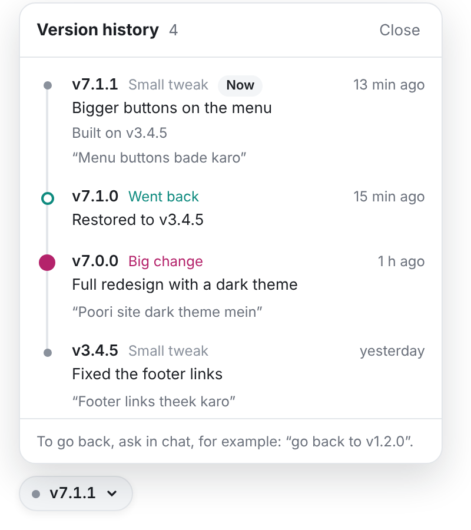

# AI Version History for Lovable, Bolt, v0, Claude Code and Cursor

[](https://github.com/atishaytuli07/ai-version-history/actions/workflows/check.yml)
[](LICENSE)

Every change your AI makes gets a number, like v3.4.5. You can see when it happened and what changed. If a change breaks something, you go back to an earlier version.

It's free. It works in Lovable now. Bolt and v0 are in testing. There's also a skill for Claude Code, Cursor and other AI coding tools.



## What it does

- Gives every change a version number.
- Adds a small button to your preview that lists all your versions.
- Lets you go back to any version. Going back is saved as a new version, so you can undo it.
- Can show the prompt that made each change. This is off unless you turn it on.

Your visitors never see the button. Only you do, in the preview.

## Start here

### Lovable

1. At the top of this page, click **Code**, then **Download ZIP**. Unzip the file.
2. Open the `lovable-kit` folder and double-click `START-HERE.html`. It opens in your browser.
3. Follow the steps on that page. Each step has a **Copy** button, so you just copy and paste into Lovable.

It has been tested live in Lovable apps made before May 13, 2026. Apps made since then use a newer setup (TanStack Start). The steps cover both, but the newer setup hasn't been tested live yet.

You'll choose one of two setups:

| | Lite | Pro |
|---|---|---|
| Needs a GitHub account | No | Yes |
| Time to set up | About 10 minutes | About 15 minutes |
| How you go back | With Lovable's History button | Type "go back to v3.4.5" in Lovable's chat |
| Good for | Trying it out, small personal projects | Real projects, private projects |

With Lite, anyone who knows your app's public key can read your version list and add versions to it. Don't use Lite for private work.

### Bolt or v0

This is still being tested. If you want to try it, read [github-layer/README.md](github-layer/README.md).

### Claude Code, Cursor and other coding tools

Run this in your project folder:

```bash
npx skills add atishaytuli07/ai-version-history
```

Or copy the `skills/versioning-ai-work` folder into your tool's skills folder. [skills/README.md](skills/README.md) lists the folder for each tool.

Then just ask your AI: "show me the versions", "what changed in v1.3.0?" or "go back to before the redesign".

### ChatGPT, Gemini and other chats

Copy the text in [chat-mode-rules.md](skills/versioning-ai-work/assets/rules/chat-mode-rules.md) and paste it at the start of a chat, or into your chat app's custom instructions. The AI will number each change it makes.

## What the numbers mean

Take v2.4.1:

- The first number (2) goes up for a big change, like a redesign.
- The second number (4) goes up for a new feature, like a new page or section.
- The last number (1) goes up for a small fix, like new text or a color.

## Before you start

- Going back brings back your code, not your data. Rows in your database and uploaded files stay as they are.
- Don't go back to a version from before you set this up.
- Keep a backup of anything important. Versions can be deleted, like any file.

## Questions

**How do I undo a change in Lovable without this?**
Open History in the top bar, pick a version and click Revert.

**Is it free?**
Yes. It's open source under the MIT license.

**Where can I read more?**
There's a full guide, with how to undo changes in each AI tool, at [aibestprompts.in/ai-versions](https://aibestprompts.in/ai-versions).

**I found a bug.**
Please open an [issue](https://github.com/atishaytuli07/ai-version-history/issues). For a security problem, see [SECURITY.md](SECURITY.md) instead.

## License

[MIT](LICENSE). Copyright 2026 AI Best Prompts.
