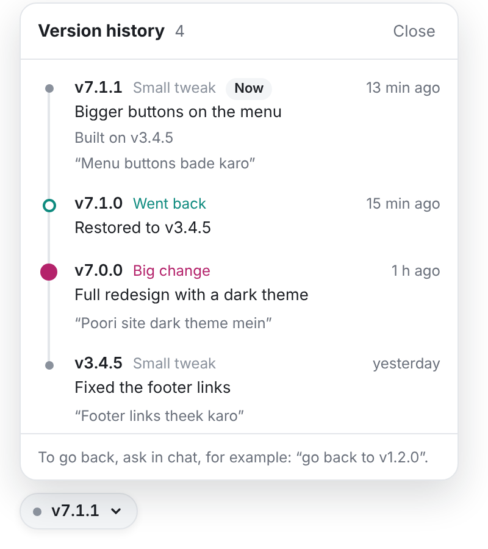

# ai-versions for Lovable

Every change you make in Lovable gets a version number, like **v2.4.1**.

A small button in your preview lists your versions: what changed and when. You can go back to any version, and going back is saved as a new version, so you can undo it too.



## What the numbers mean

```text
v 2 . 4 . 1
  |   |   |
  |   |   +--  small tweaks: a color, some text, a small fix
  |   +------  new features: a new section, page or form
  +----------  big changes: a redesign, a new direction
```

When you go back to an older version, the middle number goes up. Your newer versions are all still there.

## Choose a setup

**Lite: no GitHub needed.** About 10 minutes, all inside Lovable.

- Good for trying it out on personal or prototype projects.
- To go back, you use Lovable's History. The version button tells you which change to pick.
- If Lovable's AI forgets to describe a change, that change gets no version. Your code is still in Lovable's History.
- The version list is stored in your app's database, which anyone with your app's public key can read and add to. Don't use Lite for anything private.

**Pro: uses GitHub.** About 15 minutes.

- Every change gets a version, even if Lovable's AI forgets to describe it.
- To go back, ask in Lovable's chat: "go back to v3.4.5".
- On GitHub you can lock versions so they can't be deleted (needs a paid plan for private repos).

Pick one per project. If you already use GitHub, pick Pro.

## Good to know before you start

- **Going back never deletes a version.** History stays until you delete it. In Pro, lock versions on GitHub to stop deletion, and back up regularly.
- **Going back restores your code, not your data.** Database rows and uploaded files stay as they are, just like with Lovable's own History. If a change added or changed database tables, going back can break the app, because the tables aren't rolled back. Ask Lovable to fix it afterwards.

## Get the kit

1. Download the kit as a ZIP file. On GitHub: open [the repository](https://github.com/atishaytuli07/ai-version-history), click **Code → Download ZIP**.
2. Unzip it (double-click the file).
3. Open the `lovable-kit` folder and double-click **START-HERE.html**. It opens in your browser, with every step on one page and **Copy** buttons for every message and file.

## Next step

- Lite: the **Lite setup** section, or `lite/SETUP.md`
- Pro: the **Pro setup** section, or `pro/SETUP.md`
- After setup, for everyday use: **Everyday use**, or `HOW-TO-USE.md`
