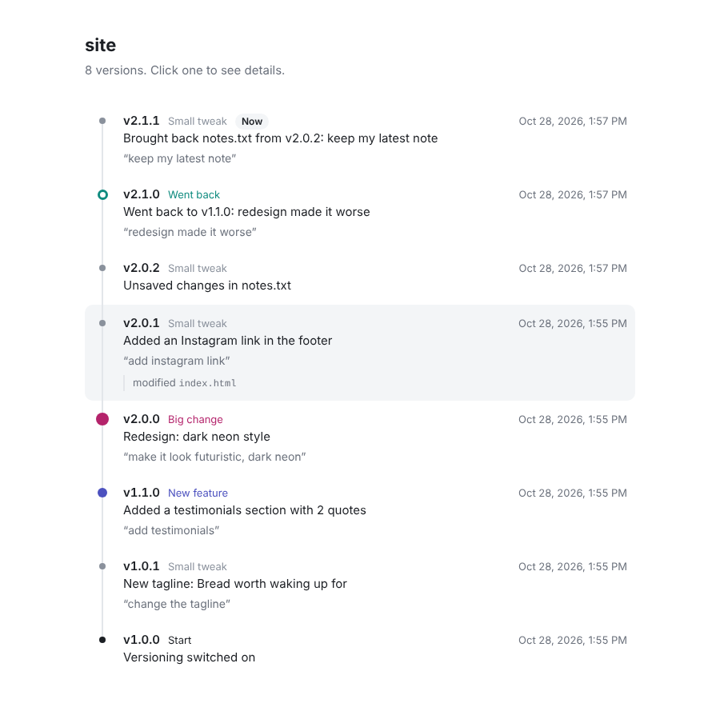

# ai-versions: a version history for your AI-built work

This is a skill: a folder of instructions an AI tool loads when it needs them. With it, every change your AI makes gets a version number, like v2.4.1. Versions stay until you delete them. You can compare versions or go back to any of them. You only need to ask.

It works in Claude, Claude Code, Cursor, Codex, GitHub Copilot, Gemini CLI, Windsurf and Replit. It works in Lovable through GitHub. Bolt and v0 also work through GitHub, in beta. For plain chats like ChatGPT, you paste in a set of rules.



## What the numbers mean

```text
v 2 . 4 . 1
  |   |   |
  |   |   +--  small tweaks: a color, some text, a small fix
  |   +------  new features: a new section, page or function
  +----------  big changes: a redesign, a new direction
```

When you go back to an older version, the middle number goes up. Your newer versions are all still there.

## What you can say

Talk to your AI in normal words. For example:

- "Show me the versions."
- "What changed in v1.3.0?"
- "Compare v1.2 and v2.0."
- "Go back to before the redesign." or "Undo that."
- "Use the old colors, but keep the new text."
- "Show me the version timeline." This makes the page in the picture above.

Going back never deletes a version. Before it goes back, the AI saves any unsaved work. Going back is then saved as a new version, so you can always undo it.

History stays until you delete it. So back up regularly. To do this, ask: "Make a backup of the versions".

---

## Install

### Get the files

1. On GitHub, open [the repository](https://github.com/atishaytuli07/ai-version-history).
2. Click **Code**, then **Download ZIP**.
3. Unzip the file.
4. Open the `skills/` folder. The skill is the versioning-ai-work folder inside it.

### Copy the folder into your tool

Copy the whole versioning-ai-work folder, not just one file. The folder contains the program that saves versions.

Each tool looks for skills in its own skills folder. Put the folder in the second column to use it in one project. Put it in the third column to use it in all your projects.

| Tool | Put the folder in | Or for all your projects |
|---|---|---|
| Claude (website or app) | Go to **Customize** → **Skills**. Click **+**, then **Create skill**, then **Upload a skill**, and choose `versioning-ai-work.zip`. Works on Free and paid plans. **Code execution and file creation** must be on (in **Settings** → **Capabilities**, it's called **Create and edit files**). | |
| Claude Code | `.claude/skills/` in your project | `~/.claude/skills/` |
| Cursor | `.cursor/skills/` | `~/.cursor/skills/` |
| Codex | `.agents/skills/` | `~/.agents/skills/` |
| GitHub Copilot | `.github/skills/` | `~/.copilot/skills/` |
| Gemini CLI | `.gemini/skills/` | `~/.gemini/skills/` |
| Windsurf (now Devin Desktop) | `.devin/skills/` (older versions: `.windsurf/skills/`) | `~/.config/devin/skills/` |
| Replit | `.agents/skills/` | No folder. Add workspace skills in **Settings** → **Customization** → **Skills**. |

Several tools also read `.agents/skills/`. So use that folder for a project you open in more than one tool.

*We checked these folders against each tool's docs on October 28, 2026. Tools move them now and then.*

### You also need Python

The skill needs Python 3.8 or newer. It is tested on 3.8, 3.11 and 3.13. You don't need Git.

To check if you have Python, open a terminal (the window where you type commands). Type `python3 --version`. On Windows, type `py --version`. If Python is missing, get it from python.org.

### Check that it works

1. Open a project in your AI tool.
2. Ask your AI: "Set up versioning for this project."
3. It should answer with something like `Set up version history. v1.0.0 saved with 12 files.`

---

## Auto-save (optional)

Auto-save works in Claude Code and Cursor. The AI offers to turn it on once per project.

Each time the AI finishes, auto-save saves any change the AI forgot to save. It saves it as a Small tweak.

You can also ask for it: "Turn on auto-save for versions."

---

## Other tools

### Lovable, Bolt and v0

Lovable is tested. Bolt and v0 are in beta: not tested live yet.

1. Connect the project to GitHub.
2. Open the repo in a tool that has this skill, for example Claude Code. (The repo, or repository, is your project's code on GitHub.)
3. Ask: "Set up ai-versions for my Lovable repo" (or Bolt, or v0).

The full steps are in `versioning-ai-work/references/app-builders.md`.

After that, you can ask the builder's own chat to "go back to v3.4.5".

### Replit

Replit Agent reads skills from `.agents/skills/` in your project (see the table above). If you'd rather not add the skill, copy the text of `assets/rules/files-mode-rules.md` and paste it into the `replit.md` file at your project's root (its top folder).

### Other agents with a rules file

This is for agents that use a rules file, like `AGENTS.md`, `.cursor/rules` or `GEMINI.md`.

1. Ask your AI once to set up versioning.
2. Copy the text of `assets/rules/files-mode-rules.md`. Paste it into the rules file.

### Plain chats

This is for chats like ChatGPT, Gemini, or Claude without code execution.

1. Copy the text of `assets/rules/chat-mode-rules.md`.
2. Paste it into the chat's custom instructions.

Versions then live in the conversation. This is less safe, so save important versions as files too.

---

## Where versions are kept

Everything lives in a hidden .ai-versions folder inside your project:

- the files of every version (a file that repeats is stored only once)
- a small record per version: number, label, summary, prompt, date
- HISTORY.md, a list you can read yourself
- a copy of the program, so the project works on its own

Git is a tool that tracks code changes. In a git project, this folder is kept out of git automatically. So switching branches can't change your history.

To move your history to another computer, chat or tool:

1. Ask: "Make a backup of the versions."
2. In the new place, ask: "Import this backup."

Your AI tool's settings and the installed skill are never part of a version. So going back can't remove them.

**If you delete the `.ai-versions` folder, your history is gone.** This can happen, for example, with `git clean -x`. So keep backups.

---

## Good to know

- **Going back restores your files, not your data.** Database rows, uploaded files in storage and other live data stay as they are. Back up data separately.
- The AI picks the label. It's usually right. If not, tell it. It learns for similar changes. Old versions stay as they are.
- Without auto-save, a change only gets a version if the AI saves it. The skill tells the AI to save after every request.
- Files over 25 MB are skipped, with a message. So are folders with over 5,000 files or over 500 MB.
- In Claude on the web, files only live inside one chat. The AI offers a backup so you keep your history.

## What's inside

```text
versioning-ai-work/
  SKILL.md              the instructions the AI follows
  scripts/aiv.py        the program that saves, compares and restores (Python, nothing else needed)
  references/           examples for picking labels, chat mode, app builders, notes per tool
  assets/github-layer/  the GitHub robot and version button for Lovable (Bolt and v0 in beta)
  assets/rules/         rules to paste into tools that don't load skills
```
